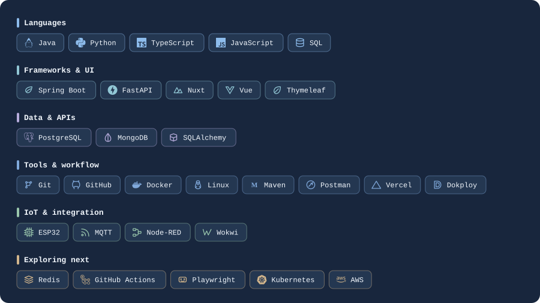

 

## Tech stack

 

## Featured projects

<h2>Featured projects</h2>

  <h2>
    <a href="https://github.com/0xRibeiro/Camus-PFC">Camus</a>
  </h2>

  

  
<strong>Oceanography · Education · IoT</strong>

  

    An oceanography learning platform combining educational
    content, gamification, marine biodiversity, and IoT integration.
  

  
<strong>Stack:</strong>
    <code>FastAPI</code> ·
    <code>Nuxt</code> ·
    <code>PostgreSQL</code> ·
    <code>ESP32</code>
  

  

---

  <h2>Icarus</h2>

  

  
<em>In development</em>

  
<strong>Travel · Planning · Exploration</strong>

  

    A travel planning platform for organizing itineraries,
    destinations, activities, notes, and trips in one place.
  

  

---

  <h2>Prometeus</h2>

  

  
<em>In development</em>

  
<strong>Books · Reading · Knowledge</strong>

  

    A personal knowledge platform for organizing books, notes,
    highlights, reading progress, and connections between ideas.
  

  

---

  <h2>Theseus</h2>

  

  
<em>In development</em>

  
<strong>Literature · Investigation · Cartography</strong>

  

    An interactive atlas of Hercule Poirot's investigations,
    mapping crime locations, victims, culprits, and case
    summaries across Agatha Christie's novels.
  

 

  Built with curiosity. Improved through practice.

