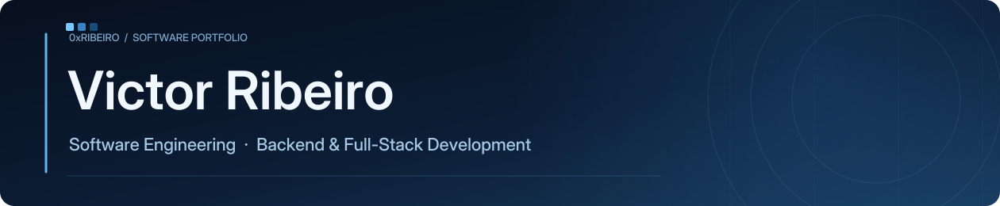

 

### About

Software Engineering student at **Universidade de Mogi das Cruzes**. Interested in backend development, software architecture, and building reliable, practical applications.

### Technologies

**Languages**

  &nbsp;&nbsp;
  &nbsp;&nbsp;
  &nbsp;&nbsp;

**Frameworks**

  &nbsp;&nbsp;
  &nbsp;&nbsp;
  &nbsp;&nbsp;

**Databases**

  &nbsp;&nbsp;
  &nbsp;&nbsp;
  &nbsp;&nbsp;

**Tools**

  &nbsp;&nbsp;
  &nbsp;&nbsp;
  &nbsp;&nbsp;

### Selected projects

 &nbsp; **[Camus](https://github.com/0xRibeiro/Camus-PFC)**

An oceanography learning platform combining educational content, gamification, biodiversity data, and IoT.  
FastAPI · Nuxt · PostgreSQL · ESP32

 &nbsp; **TaskFlow API** · *Planned*

A task management API to demonstrate authentication, role-based access control, testing, caching, and observability.  
Spring Boot · PostgreSQL · Redis · Docker

 &nbsp; **DeployBoard** · *Planned*

A full-stack service monitoring dashboard featuring live status updates, deployment history, and operational insights.  
FastAPI · Nuxt · Docker

---

  Built with curiosity. Improved through practice.

